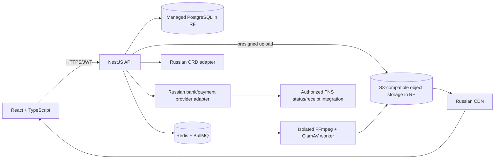

# Architecture and deployment

## Operational guardrails
- API only authorizes, validates and queues work. Never run FFmpeg in the HTTP process.
- Postgres stores metadata/object keys, never video bytes.
- Upload URLs expire quickly; quarantine objects are private and not CDN-readable.
- Use a managed PostgreSQL service with PITR, private networking and confirmed Russian data residency.
- Put Redis and workers in private subnets. Set worker concurrency from CPU/RAM benchmarks, initially 2 transcodes.
- Configure CDN origin access so only approved final objects are publicly cached; draft URLs are short-lived.
- Secrets are injected by the deployment secret manager, never committed.
- Local Compose is a development aid, not a compliant production topology.
